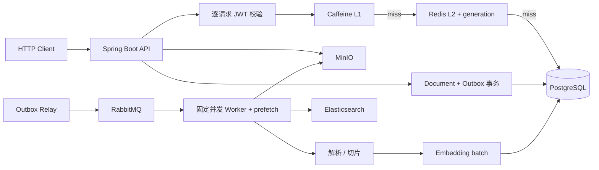

# 缓存与文档导入可靠性架构

本文描述阶段 2–4 已落地的缓存、异步文档导入、故障恢复和性能验证边界。阶段 2/3 的初始 A/B
数字见 [`stage2-stage3-report.md`](../performance/stage2-stage3-report.md)，阶段 4 的故障与参数调优结论见
[`stage4-report.md`](../performance/stage4-report.md)。

## 运行链路

## 缓存一致性边界

- Caffeine 是单实例 L1，Redis 是共享 L2；缓存 miss 最终回源 PostgreSQL。
- L2 key 携带全局和 key generation。事务提交后的失效会推进 generation，因此较早启动的 loader 即使较晚完成，也只能写入不可达的旧命名空间。
- Agent 冷 miss 使用 Redisson `RLock` 合并跨实例回源；更新后通过 Redisson `RTopic` 广播 L1 失效。
- Pub/Sub 不保存离线消息，所以跨实例 L1 还用 5/30 秒短 TTL 限制最坏收敛时间；这是最终一致性边界，不宣称线性一致。
- Redis 或 Redisson 运行期异常时缓存 fail-open，认证和业务查询继续回源数据库。JWT 的签名、过期时间与 token 类型从不被缓存跳过。

## 异步导入可靠性边界

- 上传先写 MinIO，再在一个数据库事务内写入 `QUEUED` 文档和 Outbox，成功后返回 HTTP 202。
- Relay 逐条 claim、发布并等待 Publisher Confirm；Mandatory Return 防止路由错误被静默当成成功。
- 每次 delivery 取得新的 processing token、单调 fence 和 lease。持久化与外部索引调用前后均校验所有权，避免旧 Worker 覆盖新一轮结果。
- 普通故障最多尝试三次；重试由新的延迟 Outbox 驱动。永久错误或重试耗尽进入 parking queue，失败文档可以人工开启新一轮有限重试。
- `INDEXING` 故障从已提交 chunk 恢复，不重复下载、解析和生成向量。
- Worker 并发、RabbitMQ prefetch 和 Embedding batch size 都是启动参数；改变参数后必须重启同一份 JAR，不能在同一轮中热切换。

## 调优参数

| 环境变量 | 默认值 | 作用 |
|---|---:|---|
| `APP_KNOWLEDGE_INGEST_WORKER_CONCURRENCY` | 4 | 同时处理文档的消费者数量 |
| `APP_KNOWLEDGE_INGEST_PREFETCH` | 2 | 每个消费者允许预取但尚未确认的消息数 |
| `APP_KNOWLEDGE_EMBEDDING_BATCH_SIZE` | 20 | 单次 Embedding 请求包含的最大 chunk 数 |
| `APP_KNOWLEDGE_INGEST_MAX_ATTEMPTS` | 3 | 每轮任务的最大 delivery 次数 |
| `APP_KNOWLEDGE_INGEST_PROCESSING_LEASE_DURATION` | 10m | Worker 所有权租约 |

调优结论必须同时报告上传延迟、最终 `READY` 延迟、队列积压、Embedding 最大并发与错误数。只比较
HTTP 202 的响应时间不足以证明后台处理能力提升。

## 验证入口

- HTTP 与文档基线：[`performance/jmeter/README.md`](../../performance/jmeter/README.md)
- 阶段 2/3 正式结果：[`docs/performance/stage2-stage3-report.md`](../performance/stage2-stage3-report.md)
- 阶段 4 总结：[`docs/performance/stage4-report.md`](../performance/stage4-report.md)
- 故障演练：[`performance/fault-injection/README.md`](../../performance/fault-injection/README.md)
- 导入调优：[`performance/tuning/README.md`](../../performance/tuning/README.md)

测试生成的 JTL、HTML 和服务日志保存在 `performance/results/`，该目录被 Git 忽略。仓库只提交汇总报告、
实验定义和可复现脚本，避免把本机生成物或凭证放进版本历史。
